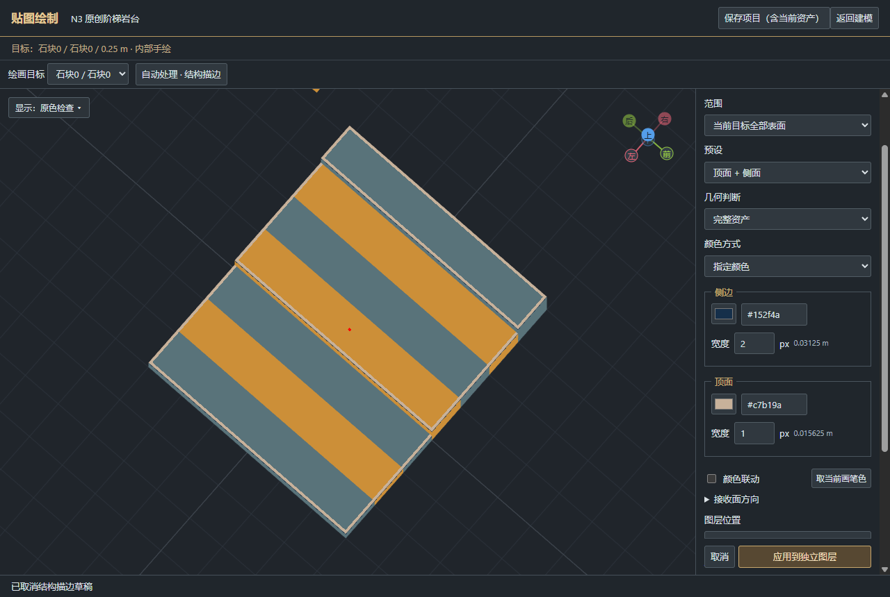

# TOOL-015 N3 交付与验证

作者结构描边N3已实现，用户视觉与手感待验收。按本次用户明确执行授权实施附件v0.1；外部ChatGPT对话未读取到正文，不声称核对了其较新消息。

## 使用与交付

在独立「贴图绘制」窗口顶部，点「自动处理 · 结构描边」→选择预设、颜色、宽度→应用到独立图层。详细说明见 `自制工具/map_editor/docs/StructureBands-N3.md`。正式EXE在 `自制工具/map_editor/release/星骸地图工坊-Workshop-M2.0/星骸地图工坊.exe`；原创练习在同包「示例/结构描边与台阶边带/project」。旧完整包保留于 `.../release/星骸地图工坊-Workshop-M2.0-before-N3-9275f46`。

正式包源码提交2195389bdd72f10ac1af3bd4fbbf65b8b35ca840（N3功能6384cfc，合入独立Spine并行提交）；源码/包指纹均为 `99216da853cd1fb9d20fe72635f3f67fab6ed81b9fbf259ee04a5fe1c5e89b4c`。后续仅测试/交付文档更新不影响运行源码指纹。

## 需求对应

| 要求 | 实际入口/模块 | 已执行验证 |
|---|---|---|
| 真凸棱/接合消缝/多精度 | StructureEdgeDomain，整数作者空间native boxes、局部边段 | structure-edge-domain.test：平板、阶梯、洞/门、对角/重叠、负坐标、三精度接合；12组随机与独立小网格oracle一致 |
| 四种预设、像素宽度、冻结颜色 | edge-band-plan，1–64px，surface continuation | 1/2/4px及20px跨面、停止于洞/转折、mask不造边、linear gain/sideColor、组合分层 |
| 正式操作/预览/取消 | 顶部入口+右栏专页，真实色带/原始/诊断 | edge-band-ui：双色、手绘保护、镜头、900px窄窗不盖模型、空选区、取消/重启；输入blur重复change与普通取消挂起均先复现后修复 |
| 原子/租约/安全替换 | outline参数命令，主端Worker重算，普通原稿层 | edge-band-lease/layer-transaction：一次Undo、ACK重复、31+2层整体拒绝、跨canvas隐藏原稿占满资产预算拒绝、过期/释放、外owner/mask/锁/手修/重排拒绝；完全被手绘遮盖的raw层替换仍保存 |
| 离开/保存/主窗退出 | 主窗保存转交子窗；一次性关闭请求ID | edge-band-parent-close-ui：主窗close/app.quit→返回/放弃/应用保存自动继续；clean直接关闭；伪造/重放ID拒绝。主窗保存N3草稿先走三选，不绕过 |
| 保存/便携/复制变换/合并 | 既有普通图层路径 | edge-band-persistence：三精度全部raw texel移动/90°/四转还原、owner复制Undo/Redo、画布及合法场景合并；export测试原生repository/便携源重读 |
| GLB/FBX+PNG | 复用既有导出器 | Blender5.1.2真实回读4案例，每例9216个外露texel按真实UV读取RGBA8精确比较；1px顶带/2px侧带/第三行空白、六面方向、tone单次合成；0.1875m³体积/2.25m²表面积不变 |
| 不堵输入/资源复用 | Worker、最近coverage缓存、单inflight+最新待算 | 改色0次边重识别/表面重查；同批面重复处理paint resource创建增量0，纯应用geometryBuild=0；取消零作者写入 |

核心 `npm test` 556通过，TypeScript检查/构建通过。旧画笔/形状/跨洞线/对称/选区/填充真实故事、图层/复制粘贴及800ms延迟确认的持续显示回归通过。没有重跑无关游戏、Spine或二维工坊全集。

## 正式EXE性能

同机1280×860/DPR1、实际可见窗口；各原创模型预热一次、3次测量，指定2px侧带、置顶以确保调色实际可见。数据全文见 `性能实测.json`，这些不是可靠p95统计。

| 模型 | 格数 | 接收边/像素/面 | Worker识别ms（三次） | 缓存改色ms | 点击至应用确认ms |
|---|---:|---|---|---|---|
| 门洞/后墙 | 1078 | 4 / 1536 / 48 | 25.3,24.8,25.2 | 0.1,0.2,0.2 | 98.0,99.1,87.4 |
| 三级阶梯 | 720 | 10 / 2560 / 80 | 18.0,20.1,19.8 | 0.2,0.3,0.2 | 99.6,102.8,98.0 |
| 混合精度手绘 | 72+288+1152（原稿1056px） | 当前owner 4 / 448 / 14 | 25.0,25.4,24.0 | 0.3,0.1,0.1 | 81.9,83.3,81.4 |

识别与改色数值是Worker内部计算，不含线程启动/IPC/纹理更新；应用数值含实际UI及确认。3例均未观察到≥50ms LongTask条目，不把它写成“主线程工作为0ms”。普通复制同条件3次：旧EXE3.0/2.8/3.1ms，新EXE3.4/2.7/5.4ms；鼠标事件中位均0.1ms，两帧显示旧29.3–29.6ms、新29.0–29.1ms。小样本保留原值，不宣称整体帧率提高或严格统计上的无退化。

## 证据与边界

- 正式EXE故事：validation/n3-exe-narrow.log；模型/截图位于 validation/surface-paint-ui-QDdaYL。
- 主窗关闭：validation/n3-parent-exe.log，validation/surface-paint-ui-dzzzBi。
- 导出：validation/n3-edge-export-opQul6/report.json、blender.log、原生/便携/FBX/GLB/PNG实物；每case9216像素。
- 性能：validation/n3-perf-exe-{gate,stairs,mixed}.log；普通复制before/after.log；延迟显示n3-commit-exe.log。
- 所有模型均为本轮原创测试/样例，无改写用户生产资产、原始附件、人工原稿或开发细则。第三方参考图未提交或发行。
- 仅轴向原生体素、凸棱硬边，不含任意导入三角网格、凹棱/裂缝、AO或实时修改器。造型变化后需要主动重新生成；重开不从普通像素反推旧参数。图层/原稿/整资产预算保持原值，超限整体拒绝。
- 团结接收未执行。用户Gate N3的效果、粗细与色调、手绘保护及手感待用户实测确认。
