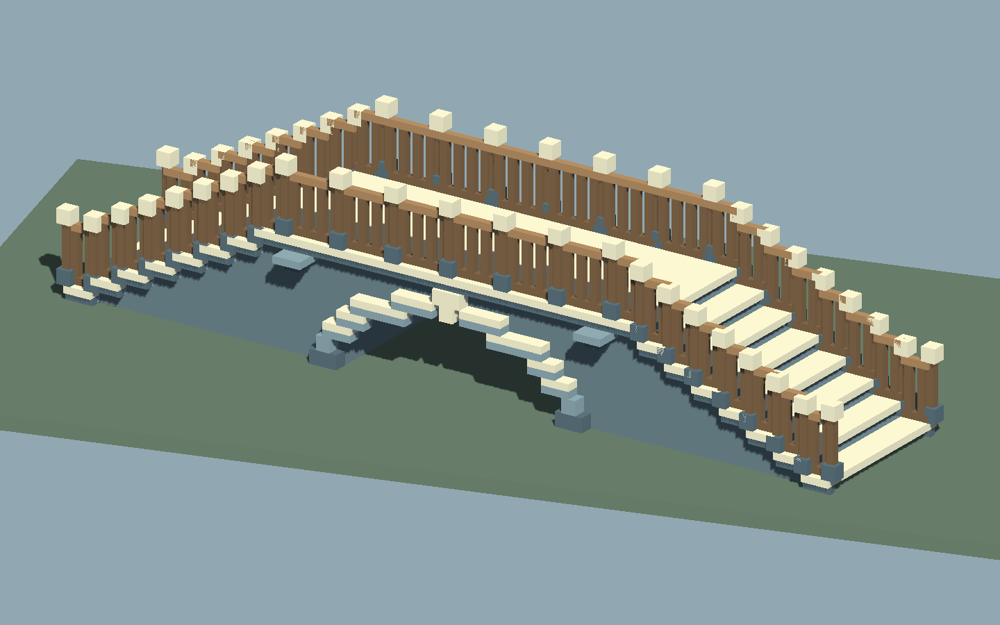
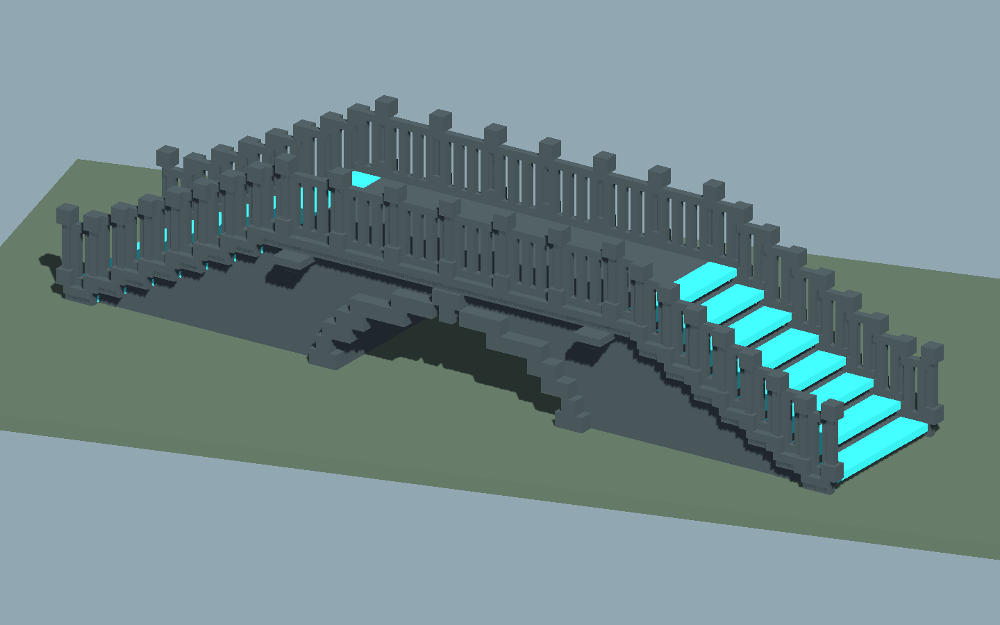
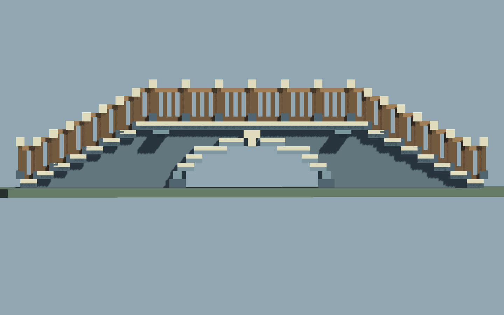

# SB-03｜阶梯石拱桥：B 专用搭建线首轮

这里实现一座可整体修改的直线单拱桥：楼梯、平台桥面、承托墙芯、拱洞和栏杆共同随尺寸变化。它开始验证“真实构件＋专属组合规则”的 B 线；A 基础地貌仍是独立作者和独立网格。本轮复用已有 Tiny Glade 记录，没有重新开游戏或占用桌面。

## 在哪里操作

继续使用现有研究工程：`Origin/work/procedural-world-editor/LE-01/project`。桥梁入口是 **星骸 → 专用搭建 → 打开石拱桥样例**，编辑窗口入口是 **星骸 → 专用搭建 → 阶梯石拱桥**。

正式项目不在本轮范围内。后台验证只使用一份临时 QA 工程；交付候选携带已验证的 A 线基线便于独立复现，部署时只加入 **Assets/SB03**。不需要再保留一套长期 Unity 工程。

## 最短操作流程

1. 打开样例，选择桥的任一部分，编辑器会找到整桥作者。也可以点击“创建标准桥”。
2. 点击“在场景拖画新桥”，在地面按住左键拖向终点；拖动更新同一座桥，松手落实。默认有拱洞的参数需要约13米以上路线；路线过短会显示原因并保留原作。
3. 用滑条修改总长、净宽、桥面标高、两端标高和拱洞尺寸，看到候选后点击“应用整桥”。也可以拖场景中的长度和标高控制柄，松手提交。
4. **Esc** 取消当前候选。右键、中键或 Alt 进入导航时先落实有效候选，导航不会使刚做出的有效操作像回退一样消失。一次提交对应一次原生 Undo/Redo。
5. “来源反查”下拉框按01—09编号显示素材实际使用范围；“在工程中显示这个源FBX”可以直接找到原模型。

总长与净宽按 **0.5m** 构件步长变化，标高按 **0.25m** 步高变化。超出可行尺寸，例如桥面太低无法容纳拱洞，候选会被拒绝；不会悄悄缩放素材或把洞填满。

## 实际用了哪些模型

[九件原创素材板](kit/index.html)展示工坊的真实源；[来源契约](kit/contracts.json)登记编号、尺寸、角色和文件指纹。默认桥使用全部9件，而非只用一两件模型加任意体素堆砌。

| 编号 | 实际构件 | 在桥上的用途 |
|---|---|---|
| 01 | 带鼻口踏步 | 两侧引道的步级 |
| 02 | 桥面铺石 | 中间水平可走平台 |
| 03 | 侧缘压顶 | 连接步级与桥面的两侧收边 |
| 04 | 木栏直段 | 随路面高低排列的栏杆 |
| 05 | 端柱 | 楼梯转高及平台处的栏杆节点 |
| 06 | 阶梯拱圈石 | 围绕受保护洞口的拱圈 |
| 07 | 拱脚 | 两侧拱圈起点 |
| 08 | 拱顶节点 | 拱圈顶部收口 |
| 09 | 桥台压顶 | 引道与水平桥段之间的支撑收口 |

素材的 `.blend`、palette FBX/PNG、制作 recipe 和预览均在 `kit/v1`。Unity直接使用实际FBX网格与色板，不重新体素化。长度和宽度通过增减完整构件适应，源构件保持比例。桥底墙芯属于配方明确允许的生成区；它先避开受保护拱洞，再输出合并外表面。

## 保存和独立使用

- **Ctrl+S / 原生场景**：保存可编辑作者、真实显示网格与碰撞。另存研究副本可用窗口里的“另存原生场景”。有候选时先应用或取消。
- **保存整桥文件**：输出 `.bridge.json`，保存参数、位置、水平转向和素材契约指纹；可载入继续编辑。示例见 [default.bridge.json](samples/default.bridge.json)。这份文件依赖对应素材版本，不是独立模型包。
- **烘焙独立预制体**：输出无桥梁作者脚本的 Mesh、材质和碰撞，供场景使用；烘焙后不再具备整桥参数编辑。

同一场景的不同桥保留各自身份与网格存储；复制作者时要分配新身份，避免两座桥写到同一份生成资产。

## 首轮边界

目前是 **直线、单孔、固定石桥风格**。不包含L转角、任意曲桥、多跨桥、自动桥墩布局、水洼或通用建筑编辑器；这些需要各自的构件接口与规则验证。

支承暂以起点水平面作为基准。它不会自动分析复杂地形，也不会自动挖掉 A 地形。桥洞的几何和碰撞会留空；若地形本身挡住洞口，需要用 A 线调整地形或抬高桥梁。A 与 B 可以搭配摆放，但不做跨线布尔融合。

原作行为只用作研究参考，本套件与生成配方是原创实现，不宣称重建了 Tiny Glade 的内部算法。当前9件是验证套件，后续可以迭代石材造型、栏杆比例和支撑风格。

## 验证依据

- [核心规则](reports/core-tests.json)：尺寸与可行性、固定源重复、开口保护、确定性等。
- [真实素材引擎检查](reports/kit-engine.json)：9/9实际FBX轴向和尺寸、踏步鼻口、原网格与UV逐点消费、绕序、色板、来源指纹通过。
- [编辑会话](reports/editor-integration.json)：候选取消、Undo/Redo、失败保护、实际碰撞净空及 A/独立物件保持。
- [保存与重开](reports/persistence.json)、[普通原生保存](reports/native-save.json)、[多桥身份](reports/multi-identity.json)：已得到对应通过记录。
- [实际相机渲染与来源对照](reports/workflow-evidence.json)：不是概念图。截图来自后台 Unity URP 相机；不代表已经测得人工操作手感或屏幕FPS。

最终场景输入8项、规则12项、编辑会话6项及独立进程重开均通过。已增量接入原研究工程，794个原有资产文件逐件指纹保持；见 [部署核对](reports/delivery-assembly.json)。历史 `*-red` 文件保留先失败的证据，不代表最终失败。

固定5次预热/20次采样：14m桥352构件合并10显示块/10556三角面，候选网格/碰撞重建P95约6.97ms；24m约9.35ms。见 [性能记录](reports/performance-unity.json)；这些是后台实际构建成本，不是屏幕FPS。

[审阅页：素材与桥上位置](review/index.html) · [完整源码包](SB-03-source-v0.1-20261103.zip)。生产源SHA256：A97EA1E4175F9368BCDD199ABEF96A8A25981410CF52F3211C1C3D42E705C203。
