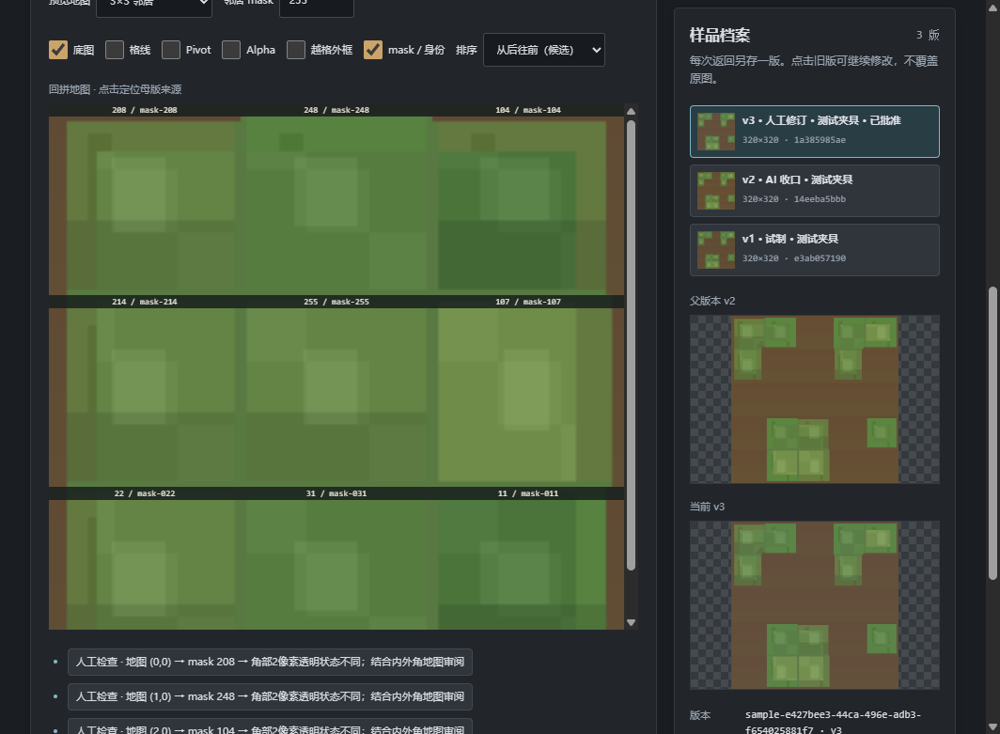

# 星骸 2D 素材任务工坊

## 2DW-TILE-02B / 工坊 0.5.0

单张手修PNG可无父图开始、准确批准并导出v8联通扩展任务；独立平面石砖模板与显式图源转换、失败返工、47/188验收。旧v1–v7和原风格规范保持。

[一页操作](docs/SINGLE-REFERENCE-WORKFLOW.md) · [真实AI可行性与待验](docs/SINGLE-TO-CONNECTED-FEASIBILITY.md) · [验证](docs/VALIDATION-2DW-TILE02B.md) · [四个原创ZIP](samples/2dw-tile02b/README.md)。继续双击启动工坊.cmd。


## 2DW-TILE-02A / 工坊 0.4.1

“样品到联通生产”增加固定视角说明与形式核对、默认标准／可选极端压制。草地使用正交俯视平面；石质使用统一顶面与朝画面下方的前暗面。新任务 spec1.5.0 / ZIPv7，旧 v1–v6 及其样包保留。换档或新图使旧批准失效；视角错误先退回试制。

[操作](docs/TILE-WORKFLOW.md) · [形式与压制候选](docs/TILE-FORM-CONTRACT.md) · [八个任务包](samples/2dw-tile02a/README.md) · [验证报告](docs/VALIDATION-2DW-TILE02A.md)。继续双击 `启动工坊.cmd`。四张真实标准／极端返回仅留本机，并未获用户美术批准；Unity 排序仍待验。

## 2DW-TILE-02 / 工坊 0.4.0

新增“样品到联通生产”：格式锁定、少量样品、独立风格收口、人工PNG回传与准确版本批准、正式母版、真实47态及九地图验收。工程持久保存、撤回/陈旧标记、异环境重新批准；普通素材与经典路径继续可用。新 art-directed 多贴片/轮廓控制为技术候选，任务 spec1.4.0 / ZIPv6，旧包定义不变。

[一页操作](docs/TILE-WORKFLOW.md) · [协议](docs/TILE-WORKFLOW-PROTOCOL.md) · [六个阶段任务ZIP](samples/2dw-tile02/README.md) · [验证及人工待验](docs/VALIDATION-2DW-TILE02.md)。双击 `启动工坊.cmd`。真实AI小样已测试；用户美术定稿、实际手修分钟数与Unity排序仍待验。



## 2DW-TILE-01 / 工坊 0.3.0

新增独立“场景地块/墙体联通”入口：草地和石质边界原创候选、绘制母版、实际PNG编译47状态、Alpha/底图/Pivot/越格/排序与回拼诊断。任务包采用spec1.3.0 / ZIP v5，旧v1–v4不变。两类真实AI与风格编辑已经参与验证，人工美术仍待验。

[操作说明](docs/TILE-PRODUCTION.md) · [验证报告](docs/VALIDATION-2DW-TILE01.md) · [两份任务ZIP](samples/2dw-tile01/README.md)。双击原有启动工坊.cmd；本次未增加运行时AI调用。

以下为前序阶段记录。

## 2DW-05B / 工坊 0.2.0

增加“场景风格继承”选择：L0/L1 与石材已批准，木材仅实验候选，其他材质待补。新增待审规则 JSON 另存入口，不自动修改批准规则。明暗各最多3阶指主要块面层级，材质弱色差按需保留。

普通任务继续 1.1.0 / ZIP v3，显式场景任务采用 1.2.0 / ZIP v4 与4个风格镜像；下文关于 v2 的说明是 05 阶段历史。13份旧包保持原字节并通过新验证器。V1 原图已持久保存并记录来源/哈希，选入任务才携带图片。

[场景风格规范](docs/ENVIRONMENT-STYLE.md) · [规则溯源矩阵](docs/ENVIRONMENT-RULE-MATRIX.md) · [三个代表任务 ZIP](samples/2dw05b/README.md) · [本轮验证报告](docs/VALIDATION-2DW05B.md)。可双击原有启动工坊.cmd 使用已构建新版本。


独立的离线 Electron 工坊，用来制作**交给 Codex 的静态 PNG 素材任务 ZIP**。它不生成目标图片、不调用 AI API，也不修改 Unity 工程。当前只支持「独立静态 PNG」与「自定义静态 PNG」两种种子，适配器只有 `codex@1`；五维身份可在模式选择下方展开查看。2DW-05 为新任务加入可信版本化流程：参考图前置分析、需求综合、决策闸门、制作、验证与交接。

双击 [启动工坊.cmd](启动工坊.cmd)，或在本目录执行 `pnpm start`。本机已安装的依赖可离线运行；首次在新机器安装依赖可能需要网络。开发环境为 Node ≥24、pnpm 11.25.0、Electron 44.5.1。

## 桌面操作

1. 选择模式，描述要制作的素材。任务 ID 在本机自动生成并在当前任务内保持不变；标题随描述、尺寸和模式自动生成。需要人工命名时展开「高级任务信息」，也可恢复自动标题。
2. 选用正方形 256、384、512 快捷尺寸，或手动设置自定义宽高、Alpha 策略及 Unity PPU。默认 PPU 为 100。勾选正方形时，未填写的高度由宽度推导；已明确填写且不等的高度会报冲突，须自行修改。点击快捷正方形尺寸会明确清除原显式高度。
3. 可选「添加 PNG」，通过系统文件选择框选 0–8 张本地图片。每张图可设为内容或风格参考，填写说明、优先级，或移除。原图片保持原字节；主进程验证 PNG 并保存临时令牌，页面不取得绝对源路径。
4. 自定义模式另有三层有序要求：硬内容、偏好、创意空间。切回普通模式后，这些要求不会进入普通任务包。人工风格文字在可展开区域；不填写也可导出。
5. 点击「检查并导出 ZIP」，工坊先按同一草稿版本核验，再打开系统另存为窗口。新增可展开「执行流程预览」，显示九步中实际启用的步骤、原因及预计产出；完整规范 JSON、计划、配方、Codex 指令和目录也可审阅。成功状态显示实际路径、SHA256 和条目数。同名文件**不会覆盖**；取消对话框保留当前草稿。
6. 「复制当前任务」保留当前可见内容、规格和参考图声明，生成新的 ID；「新建任务」清空内容和参考图，并恢复默认 PPU。复制和草稿只在当前程序会话有效，源 PNG 会在复制、预览和导出时重新核验。

新 ZIP 的素材规范仍为 Schema `1.1.0`，输出硬规格只有 `spec/asset-spec.json` 一份权威；归档明确标 `2dw-zip/2`，含 `2dw-workflow/1` 配方、分析/决策/制作计划、manifest 和真实参考 PNG。零参考包共 11 条目；未来目标 `output/asset.png` 和待执行分析报告均不在包内。历史 `2dw-zip/1`、素材规范 1.0/1.1 包仍可读，旧样包不改。默认 PPU 100 时，384×384 px 对应 3.84×3.84 世界单位；显式 PPU 200 时，512×256 px 对应 2.56×1.28。

内容图只触发内容分析，风格图只触发风格分析；没有图就跳过看图步骤。数字 priority 越大越优先，未填写不指定顺序；它不能自动解决相冲突的硬要求。外部执行者必须区分观察事实、推断和用户确认约束；看图/生图能力不足时如实交接阻塞，不能把计划当成已完成的图像分析或素材。

## 运行与验证

```text
pnpm install --frozen-lockfile
pnpm run build
pnpm run typecheck
pnpm test
pnpm start
```

`pnpm run smoke:recipe` 用真实 Electron 窗口导出零图、内容+风格、仅风格和双风格冲突说明四份 ZIP，并独立复核 manifest、原图字节、条件步骤和离线边界；证据写入忽略的 `validation/2dw05/`。`smoke:quick` 与 `smoke:workflow` 已适配新 `/2` 输出，仍复核既有快捷/动态流程并写到本轮证据目录；自动化模拟系统对话框返回值，不改旧样包。2DW-04 原生 Windows 对话框验证见其验收文档。`pnpm run smoke` 验证首轮固定样例的兼容桥接，**只应在尚无同名 proof ZIP 的隔离副本运行**。`pnpm run proof` 也会写固定 proof ZIP，不要在已有原件上重复运行。

审阅入口：[2DW-05 验收记录](docs/VALIDATION-2DW05.md) · [2DW-04 验收记录](docs/VALIDATION-2DW04.md) · [2DW-03 验收记录](docs/VALIDATION-2DW03.md) · [2DW-02 预设规则](docs/PRESETS.md) · [首轮固定样例](samples/2dw-proof-codex.zip)。

前序05B阶段没有外部可写预设库、其他 AI 适配器、AI 生图、拼接裁切、专业植物/农田规则、Unity 导入或便携发行版。本轮只新增联通PNG编译与诊断，其他边界保留。首轮 `1.0.0` 黄金 ZIP、2DW-02 A/B/C 样包与旧 `checkProof` / `exportProof` 接口仍保留。
