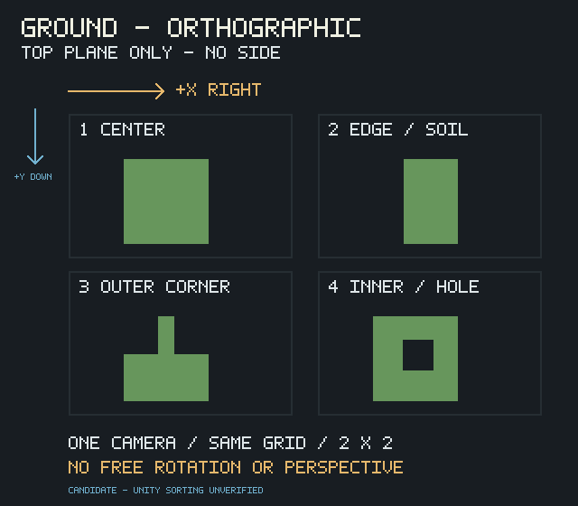
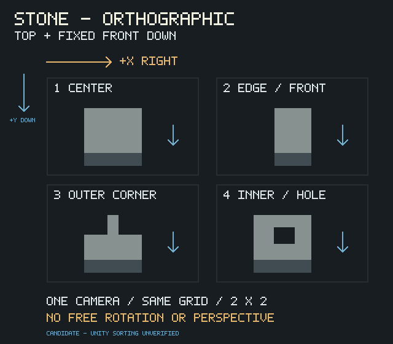

# 2DW-TILE-02A 任务级形式与压制契约

工坊 0.4.1；新任务 spec 1.5.0 / ZIP v7。本文与两张原创说明图属于本任务候选，不修改已批准 L0/L1、石材 L2、V1 视觉参考或开发细则。图中文字、箭头、边框仅作解释，不得画进返回小样。

| 模板 | 固定形式 | 合法可见内容 | 禁止 |
| --- | --- | --- | --- |
| 草地 XH-GRASS-8COND-01 | F-GROUND-TOPDOWN-v1，严格正交俯视 | 顶面、透明叶缘、平面底层 | 草土立体台、侧立面、地平线、透视 |
| 石质边界 XH-STONE-EDGE-8COND-01 | F-STONE-EDGE-FRONT-v1，统一正交顶面 | 顶面、朝画面下方的固定前暗面、边界接触暗块 | 各样自由旋转、三分之四展块、前面方向改变 |

两族都使用同相机、方格尺度、材质和照明方向。屏幕 +X 向右、+Y 向下；映射到 Unity XY 为 +X/-Y，这不是 Unity 排序轴已经验证的声明。四样使用固定 2×2 语义：左上主体／中心，右上接边／前沿，左下外角，右下内角／孔洞。语义固定不等于程序已识别或精确切出 AI 返回图。

| 压制档 | 作用 |
| --- | --- |
| off | 不追加压制；已批准基础规则仍有效 |
| standard（默认） | 成熟大块面组织，暗／亮各最多 3 个主要层级；极弱整体材质变化按需保留 |
| extreme | 每种局部材质以主体／暗块两大层级为主，有目的的结构黑线，减少碎纹与亮边，暗面停止雕刻 |

层级不是整张图的 RGB 颜色数量，不量化 PNG、不统一加粗外轮廓、不强迫不同材质同色。extreme 禁止高光细线刻硬边与连续整圈发白亮边；不能以模糊、变脏、弱对比或儿童卡通代替成熟概括。压制只作用于小样与 materials 美术，绝不作用于 contour 数值 R/G/B/A。硬格式、形式与批准身份始终优先。

文件解码成功只证明 PNG 合法。用户仍须逐项检查资产类型、同相机、无禁用面、联通生产用途，点击确认后记录准确样品 ID／修订／SHA／specHash／视角 ID／压制 ID。本机 HMAC 单独封存形式检查；异机恢复必须复查。形式不符要注明原因并返回小样试制，重试 ZIP 自动携带负向诊断；不能用风格收口合法化错误厚度。

换档、改规格或返回新图都使旧批准与正式产物陈旧；切回原档也不复活批准。已有 PNG 可通过“形式核对并继续”明确采用为当前规格新修订，字节与 SHA 不改、旧亲缘记录保留，无需再次找同一个文件。重新检查后仍须另外批准准确版本。

当前候选只可靠表达要求并提供人工 Gate，不保证生成模型一键画对。真实 AI 对照与技术夹具分开登记；最终美术、正式墙材、手修时间和 Unity 遮挡／排序仍待人工或引擎验收。
